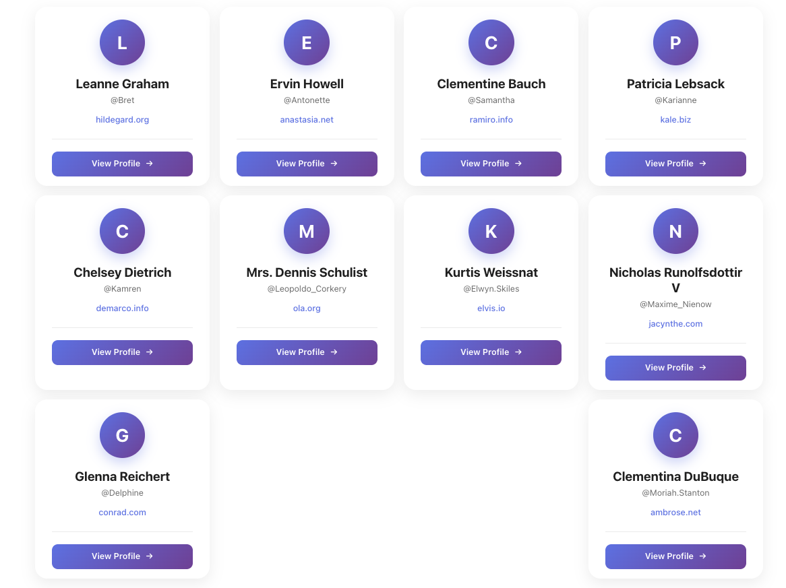
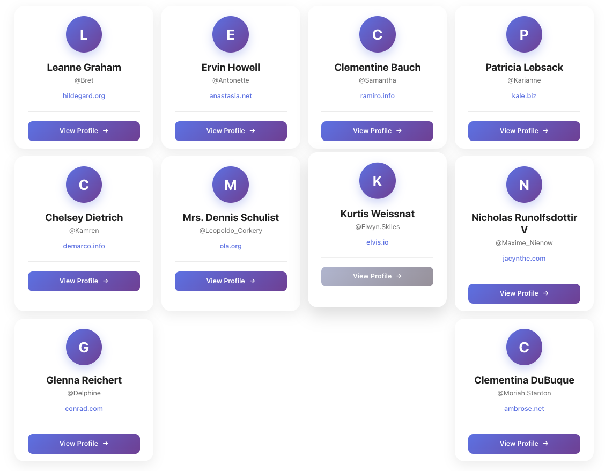
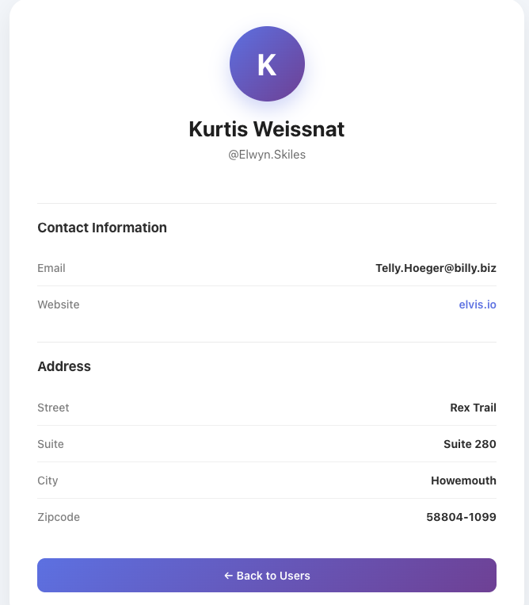
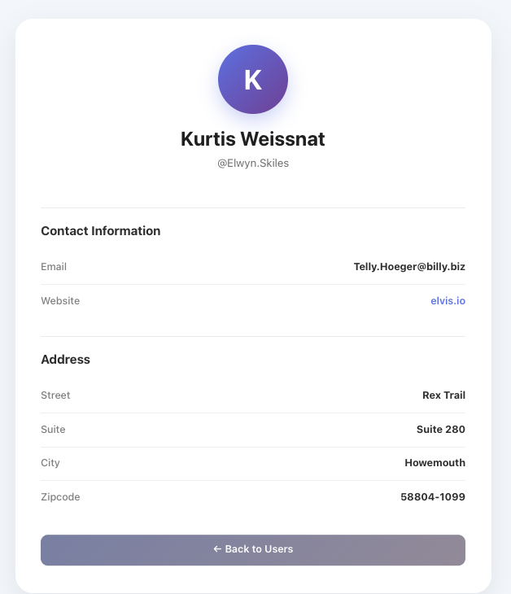
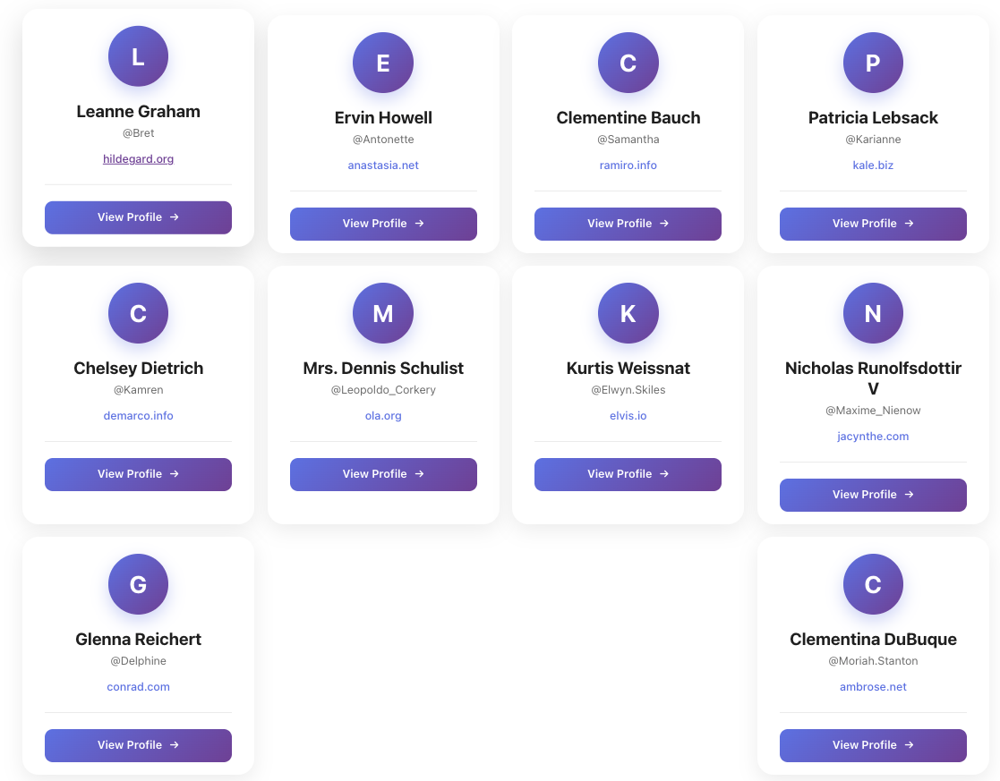

# User Directory React App

A simple and modern User Directory application built with React. The application fetches user information from the JSONPlaceholder API and displays users in responsive profile cards. Users can select a profile to view more detailed information.

Few live here [User directory app](https://userinfo-gm06.onrender.com)

## Features

👤 Display users in modern profile cards
🔎 View detailed user information
🌐 Clickable user websites
📧 Display email addresses
📍 Display user addresses
🔄 Loading state while fetching data
↩️ Navigate back to the user list
📱 Responsive design
🎨 Modern card-based UI with hover effects
🔗 React Router navigation
⚡ API data fetched using Axios


## Technologies Used

React.js
React Router
React Bootstrap
Bootstrap
Axios
CSS
JSONPlaceholder API

## API

This project uses the free JSONPlaceholder REST API.

User data is retrieved from:

```shell
https://jsonplaceholder.typicode.com/users
```

Individual users are retrieved using:

```shell
https://jsonplaceholder.typicode.com/users/{id}
```

## Project Structure

```shell
src/
│
├── components/
│   ├── Loading.jsx
│   ├── UserCard.jsx
│   ├── UserList.jsx
│   └── UserSingle.jsx
│
├── App.jsx
├── App.css
└── index.js
```




---


## User details

Each user is displayed with:

User initials
Full name
Username
Website
View Profile button

- By clicking **"MORE DETAILS"** on each card info, it navigates to the individual user details, where users can view the detail about each user such as name, address, website, etc.





### User Card

When a user selects View Profile, the application displays:

Name
Username
Email
Website
Street
Suite
City
Zipcode

The profile page also includes a button to return to the user list.

Example:


By clicking **"Back to user's list"**, it navigates to users list.



---

By clicking on each user **URL**, it navigates to the user's websites



## steps to follow in the installation

Clone the repository:

```bash
https://github.com/FemiAdesola/userInfo.git
```

```bash
cd userInfo
```

```bash
`npm install` on your terminal and press enter (to allow the installation of a packages and it's dependencies to your local node-module folder )
```

Start the development server:

```bash
Write `npm start` on your terminal and press enter (to start the live server)
```

The application will normally be available at:

```bash
localhost http://localhost:3000
```

## Main Dependencies

Install React Bootstrap:

```bash
npm install react-bootstrap bootstrap
```

Install React Router:

```bash
npm install react-router-dom
```

Install Axios:

```bash
npm install axios
```

### How It Works

The application retrieves users from the JSONPlaceholder API using Axios.

```JavaScript
axios
  .get("https://jsonplaceholder.typicode.com/users")
  .then((res) => {
    setUsers(res.data);
  });
```
